# Architecture

qi indexes directories of text documents into a single SQLite database file and searches them from the command line. The database lives at `$XDG_DATA_HOME/qi/qi.db`, or `~/.local/share/qi/qi.db` when that variable is unset, and holds the document bodies, the search index and any embeddings. Keyword search needs no configuration. Vector search is added when the config names an embedding provider, which is any server that speaks the OpenAI-compatible `/v1/embeddings` API (Ollama, llama.cpp, OpenAI).

## Diagram

## Indexing

`qi index` walks each collection's directory and brings every file's database row up to date. It skips hidden directories and common tool directories (`.git`, `node_modules`, `vendor`, `dist` and others), anything matched by the collection's `ignore` globs, symlinks, files over 10 MiB, and binary files (a NUL byte in the first 8000 bytes, the test git uses). By default a collection indexes `.md`, `.markdown`, `.txt` and `.text`; other formats must be listed in its `extensions`.

Each file goes through up to three checks, cheapest first:

1. **Stat.** qi records the size and nanosecond modification time each document was indexed from. If both still match, the file is not opened. A file modified within two seconds of the run's start gets no stored stat, so it is read again next run; this covers writes that land in the same clock tick as the read. A writer that changes the bytes but keeps the size and mtime is not detected; `qi index --force` reprocesses every file.
2. **Content hash.** qi reads the file and computes its SHA-256. If the hash matches the stored one, only the document's date is rechecked.
3. **Full pipeline.** New or changed files are parsed, chunked and stored.

The pipeline:

1. **Parse.** A parser chosen by file extension splits the file into sections and finds its title. Markdown (`.md`, `.markdown`) and MDX (`.mdx`) are parsed with goldmark and split at headings; MDX `import`/`export` lines and JSX tag lines are blanked first. reStructuredText (`.rst`) and AsciiDoc (`.adoc`, `.asciidoc`) are split at section titles, with body lines copied verbatim. Any other extension is read as one plaintext section. YAML frontmatter (and AsciiDoc's attribute header) becomes document metadata: a title, a date and tags. Its title, description and tags are also kept as one searchable section of plain text. Adding a format means one file that implements the `Parser` interface and calls `Register` for its extensions.

2. **Chunk.** Sections are cut into chunks of about 512 characters (`chunk_size`). Candidate cut points are scored by type — heading 100, code fence 80, blank line 20 — and the score is reduced the further the cut is from the target size, so chunks tend to end at structural boundaries. Each chunk records its byte offset and its first and last line in the source file.

3. **Store.** The file's bytes go into a `content` table keyed by SHA-256, so the same file indexed by two collections is stored once. The document row and its chunks are written in one transaction, and SQLite triggers copy each chunk into the full-text index. A document without a frontmatter date is dated by its file's mtime, so the `--since` and `--until` filters work on every document.

After the walk, documents whose files are gone (or are now ignored, oversized or binary) are marked inactive, and every run then compacts the database: inactive documents and their chunks are deleted, content no document references is deleted, the full-text index is merged into one segment once new segments reach a quarter of the largest, and the file is `VACUUM`ed when at least a quarter of its pages (and at least 1000) are free. Deleted files therefore leave the database in the same run. `qi delete <collection>` removes a whole collection.

When an embedding provider is configured, `qi index` then embeds every chunk that lacks a current vector, in batches (32 by default), saving each batch before requesting the next. Embedding runs after the indexing transaction commits, so a provider failure leaves the indexed text in place and the next run retries only what is missing. Each vector is tagged with a fingerprint of the model, dimension and truncation settings; changing any of them makes the old vectors stale and they are re-embedded.

Two `qi index` runs never overlap: each takes a file lock on `<database>.index-lock`, and a second run waits for the first. `qi hook install` adds git hooks (`post-merge`, `post-rewrite`, `post-commit`) that start a background `qi index --changed-since <revision>` after a pull, for every configured collection inside the repository; the run is skipped when no indexed file changed.

## Search

`qi search` runs keyword search only. `qi query` runs hybrid search by default (`--mode lexical` or `--mode hybrid`; `deep` is an alias for `hybrid`), and falls back to keyword search with a warning when no embedding provider is configured.

Keyword search uses SQLite's FTS5 full-text index, with Porter stemming, ranked by BM25, a standard relevance score based on how often the query terms appear in a chunk and how rare they are across the corpus. The query is reduced to letters and digits, common English stop words are dropped, and each remaining term is quoted, so all terms must match. If that finds nothing, qi retries without instruction words such as "summarize" or "briefly", and then with any term matching (`OR`). A document is represented by its best-ranked chunk, and retrieval stops after `bm25_top_k` (default 50) distinct documents.

Hybrid search adds vector search on top of that:

- If the top BM25 score is more than three times the second, the BM25 results are returned and the query is not embedded.
- Otherwise the query is embedded, and qi computes the cosine distance between the query vector and the stored vectors of the chunks of BM25's candidate documents. When BM25 returns fewer documents than its pool size, the candidates are topped up to `vector_top_k` (default 50) with the best documents matching any query term. Only when BM25 finds nothing at all are all embedded chunks scanned. A document that shares no word with the query therefore reaches the results only through that full scan.
- The two ranked lists are merged with Reciprocal Rank Fusion (RRF): each document scores `Σ 1/(60 + rank)` over the lists it appears in, counted once per list at its best rank. RRF uses only rank positions, so BM25 scores and cosine distances never need to be put on the same scale.

If embedding the query or the vector search fails, the BM25 results are returned. Both commands finish with the same post-processing step: an optional sort by date over the whole candidate pool, removal of results with identical snippets, one result per document, then the `--limit` cut. `--path` globs filter results inside retrieval, before that cut, so an in-scope match is not displaced by out-of-scope ones.

## Example

Say `~/notes/sqlite.md` has frontmatter `date: 2026-03-01`, a heading `## WAL mode` and two paragraphs under it. On the first `qi index ~/notes`, the file has no stored stat, so qi reads and hashes it, the Markdown parser takes the date from the frontmatter and produces a section with heading path `WAL mode`, and the chunker cuts it into one or two chunks with line ranges. The body goes into `content`, the file gets a `documents` row dated 2026-03-01 with its size and mtime, its chunks go into `chunks`, and the triggers add them to `chunks_fts`. If Ollama is configured, the chunks are then embedded and their vectors stored. On the next run, the size and mtime still match, so the file is not read.

`qi query "how does WAL mode work?"` drops the stop words "how" and "does" and the question mark, and searches for `"WAL" "mode" "work"`. The heading path is indexed with the chunk text, and stemming lets "work" match "works" or "working", so the WAL chunk matches if its text uses any form of "work"; if it does not, the any-term retry finds it. The note's document becomes a vector candidate, the query embedding lands close to the WAL chunk, and RRF ranks the note near the top. The result shows the chunk's snippet, the file's content hash, a `qi://notes/sqlite.md` URI and the chunk's line range.

## Database Schema

One SQLite file in WAL mode. The schema is built by the numbered migrations in `internal/db/migrations/`, applied in filename order and recorded in `schema_version`.

| Table | Purpose |
|---|---|
| `content` | File bodies keyed by SHA-256. A file indexed by several collections is stored once. |
| `documents` | One row per file per collection: path, title, content hash, active flag, date (`doc_timestamp`), tags, and the size and mtime it was indexed from (`file_stat`). |
| `chunks` | Text segments with sequence number, heading path, byte offset and source line range. |
| `chunks_fts` | FTS5 index over chunk text and heading path, kept in sync by triggers on `chunks`. It runs with `secure-delete`, so deleted text is removed from the index when the run commits. |
| `chunk_vectors` | Embedding vectors as little-endian `float32` BLOBs, one per chunk. |
| `embeddings` | Provider, model, dimension and fingerprint for each vector. |
| `index_runs` | One row per collection per index run: start and finish times, file counts and any error. |

Collections are not stored in the database. The config file lists them; `documents.collection` records which one each document belongs to.

## Under the Hood

**SQLite without CGo.** qi uses `github.com/ncruces/go-sqlite3`, which compiles SQLite to WebAssembly and translates it to Go with wasm2go, so qi builds with `go install` and no C toolchain.

**Vector search in Go.** `sqlite-vec`, the usual SQLite vector extension, has Go bindings only for an older `go-sqlite3` that ran on the wazero runtime, and its WebAssembly build needs features that runtime does not enable. qi instead scans `chunk_vectors` in SQL and computes cosine distance in Go. The scan reads only IDs, path and vector; chunk text and document metadata are fetched afterwards for the selected results. Bounding the scan to BM25's candidates is what keeps hybrid queries fast on large corpora: on a 424k-chunk benchmark recorded in `CLAUDE.md`, a hybrid query went from 1.41s to 0.01–0.06s, while the full-scan fallback stayed at about 1.3s.

**Config.** The config is plain YAML read with `gopkg.in/yaml.v3`; qi expands `~` and resolves relative paths itself.

## Related Docs

- [`docs/configuration.md`](configuration.md) — all config fields with examples
- [`docs/config.example.yaml`](config.example.yaml) — fully annotated config file
- [`docs/named-collections.md`](named-collections.md) — collections guide
